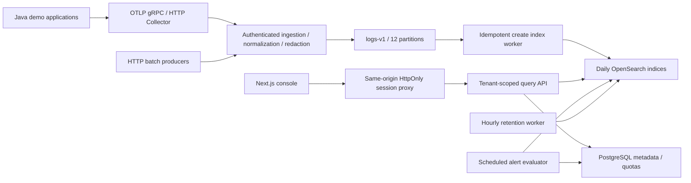

# Architecture and implementation boundaries

Reference: Option C, collector → gateway → Kafka → index worker → OpenSearch; PostgreSQL holds control-plane data.
Option D adds regional gateways, independently operated search clusters and archive manifests. Direct OpenSearch
ingestion couples clients to search credentials and overload. Collector-only buffering is simpler but bounded disk
queues cannot replace a replicated durable transport.

API and worker currently share an executable; WORKER_ENABLED=false disables indexing only. Alert/retention jobs run on
all replicas; alert rows use SKIP LOCKED. Retention jobs are idempotent, but lack distributed leasing. JVM resource
competition remains a limitation. Single-item bulk indexing is deliberately simple and inefficient; there are no partial
multi-item retries to claim verified. Permanent mapping failures block a partition until operator repair; no automatic
DLQ exists.

Kafka partition key combines source and identity hash prefix, distributing a hot source over partitions. This sacrifices
source ordering; there is no global chronological ordering. Production requires RF=3, min.insync.replicas=2, acks=all,
encrypted authenticated brokers, appropriate disks and AZ placement. Compose RF=1 survives process restarts with an
intact volume, not node/disk loss.

Daily indices use event date, explicit keyword/text/date fields, dynamic:false and disabled arbitrary attribute
indexing. This prevents mapping explosion but structured arbitrary-attribute filtering is not implemented. Stable
tenant/source/event ID hashes use create operations; conflicts retain the first indexed value. Identity reuse across
different event dates can create duplicate documents in separate indices. Producers must retain immutable timestamps and
payloads for retries. There is no universal exactly-once guarantee.

Queries always add tenant from the verified JWT claim; caller DSL is never accepted. Search-after uses date and stable
ID, without PIT: concurrent refresh/deletion can change pages. Seven-day range, 500 results and two-second search
timeout bound individual requests; cluster-wide concurrency admission remains missing. Search uses shared indices and a
trusted backend service identity: an OpenSearch credential leak bypasses logical isolation.

SSE polls searchable logs over an overlapping 30-second window, keeps 1,000 IDs and admits 16 streams per JVM. It emits
a gap notice above 100 results/window. It is best effort, delayed by indexing/refresh, and has no durable resume cursor.
Slow connections occupy at most those slots but write timeout enforcement needs further work. Historical search is
recovery.

Alerts count indexed ERROR events in a rolling five-minute event-time window every 30 seconds. PostgreSQL row locks
serialize state transitions; history records firing/resolved transitions. Late events can miss a window. Notification
delivery, silencing and acknowledgments are not implemented.

Retention deletes hot documents by tenant/event timestamp only for configured policies, at hourly granularity. Kafka's
shared 24-hour retention and collector retry/disk settings are independent; no cross-tier deletion or legal-hold
guarantee exists. S3 archive/restore and backup erasure are not implemented. Do not use this baseline for regulated
retention requirements.

Compatibility references
consulted: [Spring Boot 3.5 system requirements](https://docs.spring.io/spring-boot/3.5/system-requirements.html), [Next.js installation](https://nextjs.org/docs/app/getting-started/installation), [Collector configuration](https://opentelemetry.io/docs/collector/configuration/).
Java 21 is within Boot's supported runtime range. Local frontend type/build checks establish compatibility for the
pinned dependencies only.

## Subsequent indexing changes

Index workers now use batch listeners (100 records/poll), partition into approximately 1 MiB bulk chunks, and retry
eligible failed items only within three local attempts. Transport uncertainty and exhausted retries withhold offset
completion; the poll can replay idempotently. Mapping-type permanent item failures are acknowledged to
logs-quarantine-v1 before source offset completion. Read-only/auth/storage configuration failures (403/404) remain
retryable, avoiding mass quarantine during storage incidents. Quarantine has at-least-once delivery and needs controlled
replay and retention management.

Kafka's data mount is explicitly configured and initialized with ownership for the nonroot broker. The initializer owns
only the application's named Kafka volume. This fixes a real startup defect; node/disk loss remains outside the RF1
failure model.

Bulk response classification follows
the [OpenSearch Bulk API](https://docs.opensearch.org/latest/api-reference/document-apis/bulk/); batch completion and
replay
follow [Spring Kafka error handling](https://docs.spring.io/spring-kafka/reference/kafka/annotation-error-handling.html).
